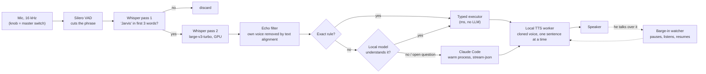
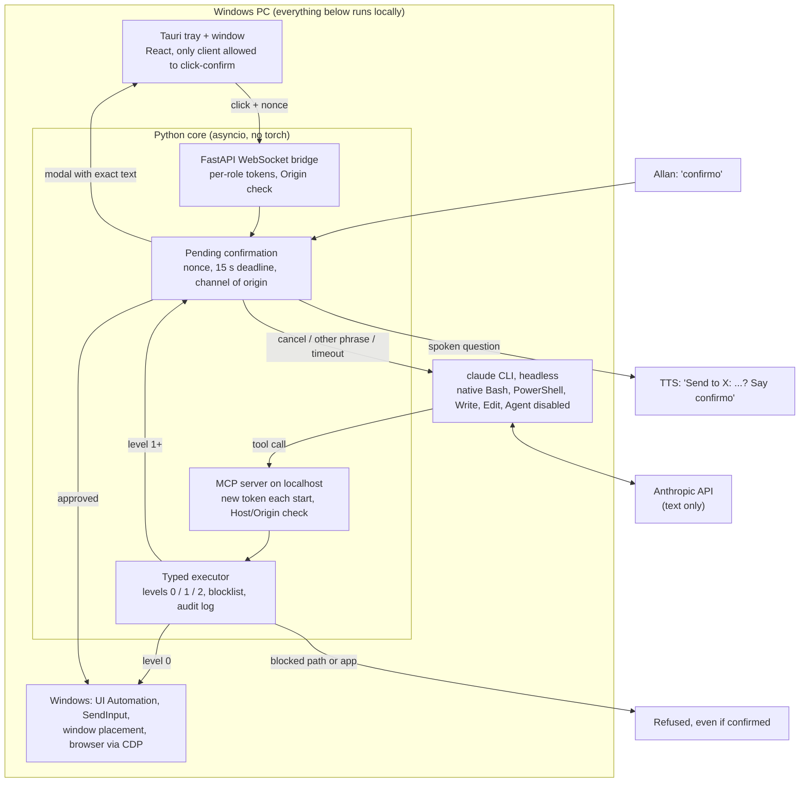

<h1 align="center">Jarvis</h1>

  <strong>A local-first voice assistant for Windows that uses Claude Code as its brain and acts on the PC through typed, permissioned tools.</strong>

  Built for one user: a developer who wants to talk to his computer in Brazilian Portuguese and have it actually do things.

---

## What it is

Jarvis is a personal voice assistant that runs on Allan's Windows 11 desktop and starts with the system from a tray app. He says "Jarvis, ..." and it opens any installed app or site, controls media and volume, arranges windows across two monitors, saves and restores screen layouts, sets reminders, reads notifications and the screen, plays and transcribes WhatsApp voice notes, sends WhatsApp messages and replies to Gmail after a spoken confirmation, and answers open questions with web research.

Simple commands never touch an LLM. Everything else goes to Claude Code running headless on his own subscription, which can only act through Jarvis's own tool server. All audio stays on the PC: wake word, transcription and the voice itself run on the local GPU. Only text goes to the cloud.

## The problem

Off-the-shelf assistants are either cloud-first (audio leaves the machine), English-first, or unable to do real work on a desktop. An LLM agent with a shell can do real work, but a shell approved by voice is a security hole: one misheard "yes", or one web page with injected instructions, and it runs anything.

The goal was an assistant that feels like a conversation (short spoken answers, follow-ups without repeating the wake word, interruptible) while every action it takes is typed, levelled, confirmed when it matters, and logged.

## How it works

1. **Listen.** A hardware knob (remapped to F13) is the master switch. With the mic on, Silero VAD cuts each phrase and a first Whisper pass checks for "Jarvis" in the first three words.
2. **Transcribe.** A second pass with `large-v3-turbo` on the GPU transcribes the command. Phrases that overlap Jarvis's own speech have the echo stripped by aligning the text against what it just said.
3. **Route.** Exact commands ("pause", "volume 30") match local rules. Free-form phrases go to a small local model for a structured reading. Anything open-ended, or any follow-up in the next 30 seconds, goes to Claude.
4. **Act.** Rules call the typed executor directly. Claude calls the same executor through an MCP server inside the core, with confirmation levels attached to each action type.
5. **Speak.** The answer is split into a short spoken line and a detailed panel in the window. The spoken line streams to a local TTS worker sentence by sentence. If Allan talks over it, it pauses, listens, and resumes if the interruption was not for it.
6. **Remember.** Each conversation becomes a note in his Obsidian vault and an SQLite FTS5 row, so "go back to the conversation about X" works across restarts.

## Architecture

- **`jarvis-core`** (Python 3.12, uv, about 26k lines in 97 modules): audio, wake word, routing, executor, brain, conversations, voice queue, reminders, game mode, VR mode. It is the source of truth and works without the UI.
- **`jarvis-ui`** (Tauri 2 + React 19, about 5.4k lines of TS): tray icon painted with the current state color, a panel with answers, cards and charts, typed input, and the confirmation modal. It also supervises the core: it watches the port and restarts the core if it dies.
- **Voice workers**: each TTS engine runs in its own process and its own venv, talking to the core over stdin/stdout. Torch pins never touch the core.
- **Job Object**: every `claude` process and worker is bound to the core, so Windows kills them if the core dies.

### Security model

The level belongs to the action type, never to what Claude says about it.

| Level | What | Confirmation |
|---|---|---|
| 0 | Apps and sites Allan asked for, media, volume, reminders, window placement, layouts, reading notifications, tabs and screen on request | None, written to the audit log |
| 1 | Anything Claude wants to open outside the catalog, system tools, reading a file outside the vault, creating a folder or text file, **sending a WhatsApp message, replying to an e-mail**, closing several windows or a whole browser, closing idle tabs | Spoken "confirmo" or a click, within 15 s. The question states the recipient and the exact text |
| 2 | Reserved for destructive actions | Voice **and** click, never from a remote channel |
| Never | Password vaults, browser profiles and cookies, SSH and cloud keys, `.env`, banking and payment tabs, Jarvis's own folders, any `.claude` folder, shells and script hosts (cmd, PowerShell, regedit, mshta and similar) | Refused, even if he confirms |

- Claude has no free shell. Its native shell and file-writing tools are turned off; it can only create plain text files with safe extensions and never overwrite.
- At most 6 actions per response, so a malicious page read by Claude cannot open 50 tabs.
- Content read from the PC (messages, e-mails, pages) reaches Claude marked as third-party data. The persona never acts on instructions found there.
- A spoken "confirmo" only counts after Jarvis stops talking, so its own voice or the TV cannot confirm. A confirmation belongs to the channel that asked: a typed "confirmo" from another client does not count.
- The local web bridge only listens on localhost with an Origin allowlist, so a site open in the browser cannot send commands to it.

## Engineering decisions

**1. Claude Code CLI as the brain, not the Agent SDK or a raw API loop.** Jarvis drives the official `claude` binary headless (`stream-json` in and out, one warm process per conversation) on Allan's own subscription, with a clean environment and a `jarvis diagnostico cerebro` check after every CLI update. This gave sessions, resume, fork and web search for free. Cost: the tool surface is whatever the CLI exposes, so each update is re-verified (one release added scheduling and messaging tools the plan did not expect; they are filtered out with an explicit tool list).

**2. Typed MCP tools instead of an approved shell.** Claude talks to an MCP server inside the core (78 typed tools today), and each tool maps to an executor action with a fixed level and a path blocklist resolved after symlinks and junctions. Chose this over "shell with confirmation" because one approved free command escapes every rule. Cost: every new capability is code and tests, not a prompt.

**3. Wake word through Whisper, not a wake-word model.** The off-the-shelf `hey_jarvis` model scored a median of 0.04 on Allan's pronunciation. Instead, VAD cuts the phrase, a Whisper pass with "Jarvis" as hotword checks the first three words, and low-confidence hits are re-checked without the hint. Phrases that are just a recitation of the prompt examples are rejected. Cost: activation only happens after the phrase ends, and another person saying "Jarvis" still passes (a speaker verifier is the planned fix).

**4. Hybrid routing: rules first, small local model second, Claude last.** Exact commands answer in milliseconds from `hassil` rules. Free text goes to `qwen3.5:4b` on Ollama with a JSON schema; if the model disagrees with a matching rule, or takes more than 2.5 s, the rule wins. Confirm and cancel never pass through a model. Cost: three paths to keep consistent, and a 3.1 GB model resident on the GPU.

**5. Echo handled in text, not only in audio.** WebRTC echo cancellation fed into Whisper cut Allan's own words during double talk (10 of 10 keywords dropped to 6 of 10). So the canceller only measures how much of a phrase came from the PC, and the echo is removed by aligning the transcript word by word against what Jarvis just said. Barge-in on speakers was then turned off by default after live use showed false stops; with headphones it stays on. Cost: someone repeating three of Jarvis's words over its speech can lose those words.

**6. Game mode returns the GPU.** Measured on 2026-10-23: Jarvis held about 7 GB of a 16 GB GPU while he played. Now, when a listed game is running, it stops the TTS worker (falls back to the built-in Windows voice), unloads the local model, and keeps only Whisper so he can still call it mid-match. Everything returns 2 minutes after the game closes. Cost: a robotic fallback voice while gaming.

## Results

In daily use since 2026-09-24, starting with Windows from the tray app. Measured numbers, all from the project docs:

- **Transcription:** `large-v3-turbo` float16, 114 ms p95 for phrases up to 5 s (2026-09-24).
- **Activation on his recorded voice bank** (2026-09-24): command activated 95% close, 96% with music, 86% at 2 to 3 m.
- **Local routing model** (2026-09-24): chosen among six models; 92.4% average accuracy against 83.2% for rules alone, 95% against 37% on natural phrasing, 0.23 s.
- **False wake words** (2026-09-25): on 34 saved activations, 9 false ones blocked and all 25 real ones accepted after tightening the confidence check.
- **Barge-in** (2026-09-25, recorded test): 20 of 20 interruptions detected, median 300 ms, max 500 ms, none false on PC audio.
- **Claude latency** (2026-09-25): a factual answer spoken in 2.6 s from a cold start; "put on a cake recipe video" found and played in 3.6 s.
- **Voice** (2026-10-22): switched from XTTS-v2 to OmniVoice after a blind test, mean score 4.67 of 5 against 4.33, character error rate 1.9%, about 0.47 s to first audio in the test.
- **Codebase** (2026-10-26): 169 commits in about five weeks, 636 test functions in the core, including a full listening session replayed from his real recordings and a fake `claude` that speaks the stream-json protocol.

## Stack

- **Audio and speech:** sounddevice (WASAPI), Silero VAD, faster-whisper `large-v3-turbo` on CUDA, livekit WebRTC APM
- **Understanding:** hassil rules, rapidfuzz, Ollama with `qwen3.5:4b`
- **Brain:** Claude Code CLI headless (Sonnet by default, Opus or Haiku switched by voice), MCP over local HTTP
- **Voice:** OmniVoice (XTTS-v2 kept as fallback engine, Windows SAPI as last resort), one process and venv per engine
- **Core:** Python 3.12, uv, asyncio, FastAPI, Pydantic v2, ruamel.yaml with JSON Schema validation
- **Desktop:** Tauri 2 (Rust), React 19, Vite, TypeScript
- **Windows integration:** UI Automation, SendInput, Core Audio, Job Objects, DevTools protocol for a separate browser profile
- **Data:** SQLite FTS5, JSONL audit log, Markdown notes in an Obsidian vault
- **Tests:** pytest

## My role

Solo project. I wrote the plan, ran the risk spikes (wake word, transcription, echo, voice blind tests, CLI policy), and built every part: the audio pipeline, the routing, the executor and its security model, the MCP server, the Claude Code integration, the Tauri app and the Windows automation. Every behavior change is recorded as an ADR (74 so far), usually triggered by a real failure in daily use and validated against saved recordings before shipping.

---

> Source code is private. This repository is a case study.

<a href="https://github.com/AllanHert">github.com/AllanHert</a>

